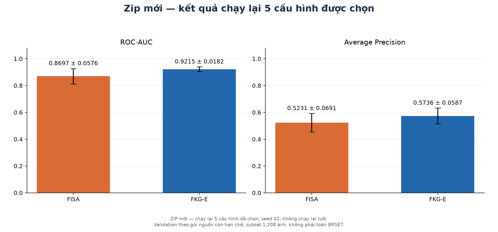
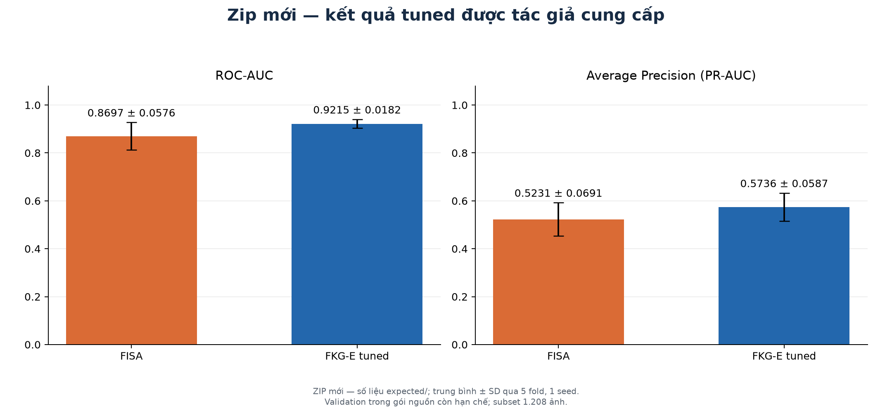
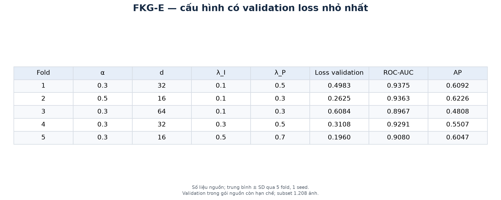
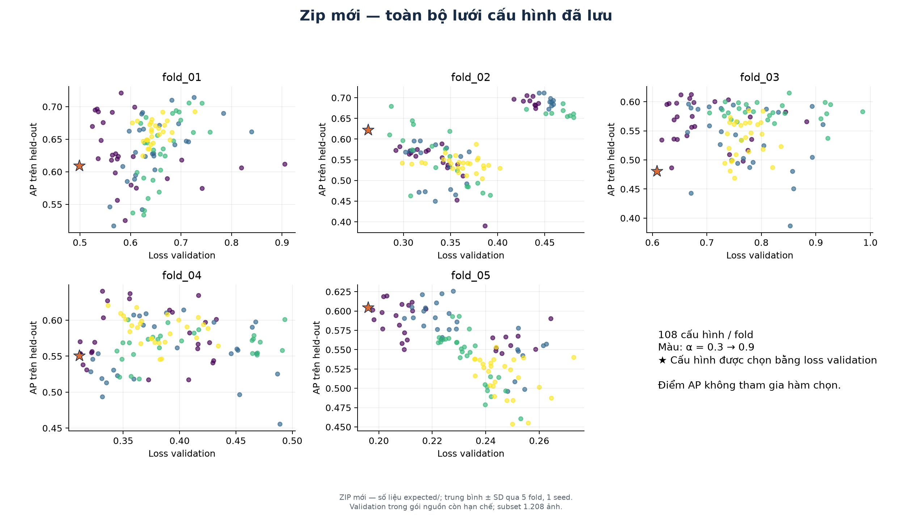
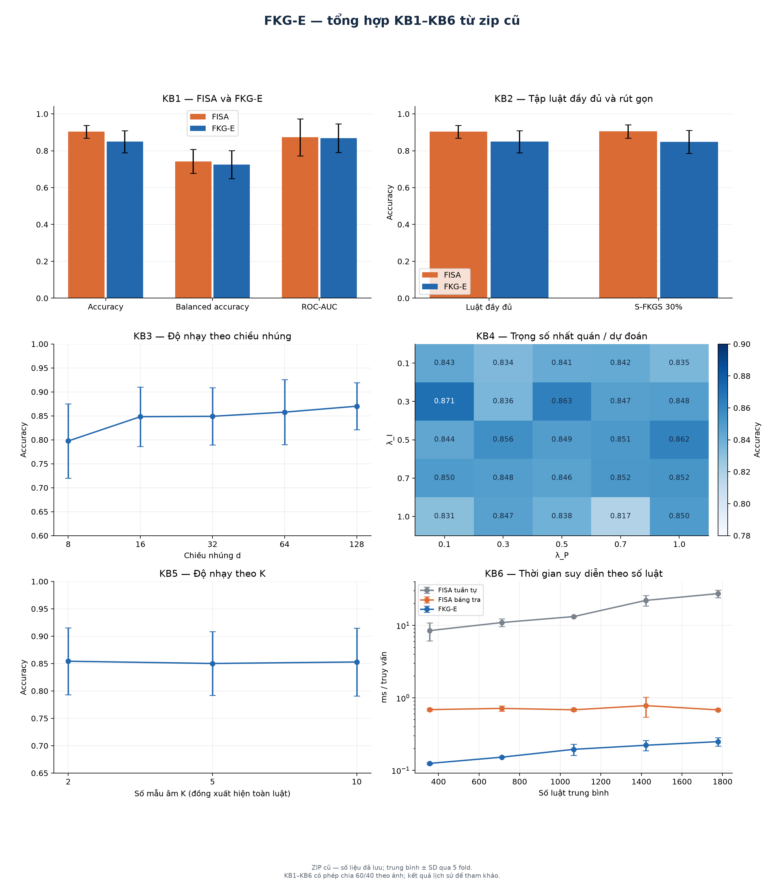
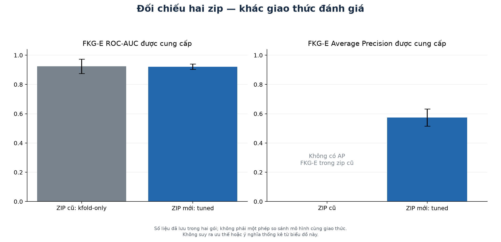

# FKG-E result images from the two supplied BRSET packages

The **new tuned zip is the primary source** for this gallery. It contains a
108-configuration search per fold and a PR figure; the older zip contains the
KB1–KB6 results and a separate `kfold-only` evaluation.

Two operations are kept explicit:

- Archived figures are rendered directly from the JSON metrics in each zip.
- The five configurations already selected in the new zip are trained again,
  using the supplied source, seed 42 and a maximum of 200 iterations. The
  resulting held-out scores generate the new PR and learning-curve figures.
  The 108-configuration search itself is not rerun.

This is a reproduction of the supplied protocol, not a correction of its
validation design. The reviewed limitations still apply: inner validation is
split from preprocessed/SMOTE data and its rules/labels remain in the learned
graph. Every figure identifies its source and scope. Neither package establishes
full-BRSET model performance; these experiments cover the 1,208-image subset.

## Numerical statistics in the FKG-E report layout

Read the [complete numerical report](results/statistics/report.md). It follows
the supplied FKG-E report sections and the table layout already used by
`fkge_v2/report/render_brset_quick_table.py`; no metrics from that different
implementation are mixed into these results.


The report includes all seven classification metrics, paired differences and
fold wins, selected configurations, split counts, thresholds, teacher
temperatures, stopping diagnostics and timing. All 70 classification values
(seven metrics, two models, five folds) are checked against the new zip.

The older package is summarized separately as KB1–KB6, ablation and baseline,
with [a six-table image](results/statistics/old_zip/result_summary.png) and full
CSV tables. Each SD uses five fold-level values, after averaging seeds within
folds. Original within-seed SDs are not pooled as independent observations.
Missing metrics stay missing. In particular, old F1 macro and new F1 for the
positive class are labeled separately.

CI/p-value formulas from the new package are reproduced only in a clearly
marked reference appendix. The original NB denominator counts training rows
after SMOTE; these values are not presented as evidence of significance.
The new zip does not contain JSON outputs for KB1–KB6, ablation or baseline;
the report does not present the older outputs as new experiments.

## New zip: main gallery

Actual selected-configuration replay:




Values supplied by the author, rendered without retraining:







The supplied FKG-E means are ROC-AUC **0.9215 ± 0.0182** and AP
**0.5736 ± 0.0587**; FISA means are **0.8697 ± 0.0576** and
**0.5231 ± 0.0691**. The selected alpha values are 0.3, 0.5, 0.3, 0.3, 0.3.
The replay values and their differences from the supplied metrics are stored in
`results/aggregate_results.json`, under `replay`.
The published replay completed all five folds in 501 seconds. FKG-E and FISA
ROC-AUC/AP differences from the supplied values were zero in every fold. Its
1,208 test image IDs are unique across folds, and the 729 test patients do not
overlap between folds. All 20 exported-fold hash checks passed (allowing only
CSV line-ending normalization).
Here PR-AUC is the package's Average Precision (AP), calculated with
`sklearn.metrics.average_precision_score`; it is not trapezoidal integration.

Error bars are descriptive sample SD across five fold-level values. They are
not CIs, do not create 50 independent samples and do not establish significance.
The grid figure verifies that the selected row minimizes the supplied validation
loss; displaying a held-out metric does not make that validation independent.

## Older zip: KB1–KB6 gallery



Individual images: [KB1](results/old_zip/kb1.png), [KB2](results/old_zip/kb2.png),
[KB3](results/old_zip/kb3.png), [KB4](results/old_zip/kb4.png),
[KB5](results/old_zip/kb5.png), [KB6](results/old_zip/kb6.png).

These are **historical metrics**, not fresh training runs. Each point is a mean
of the five fold-level seed means; SD is calculated across those five values.
The older KB workflow split the held-out fold 60/40 by image for fitting and
evaluation and had patient overlap across those two portions. Its KB1–KB6
figures are retained for traceable comparison, not endorsed as leakage-free.

The older zip's separate `kfold-only` ROC-AUC is approximately 0.9242. Its KB1
ROC-AUC is approximately 0.8681, from a different evaluation workflow. The
renderer reads the corresponding source for each figure and does not substitute
one result for the other. The older FKG-E results do not include AP; an AP value
is not reconstructed from ROC-AUC or hard predictions.



The two protocols differ. This side-by-side display is not an experiment that
establishes model superiority.

## Files and provenance

- `render.py`: reads both zip archives and creates all PNGs and aggregate JSON.
- `summarize.py`: rebuilds the numerical report, 16 CSV tables and two table
  images, without training models.
- `replay_selected.py`: exports the new package's folds and replays its selected
  models using a fresh cache, with Windows-compatible process spawning.
- `requirements-replay.txt`: original numerical/plotting package versions.
  Linux-only NCCL is omitted because this is a CPU run; Windows adds colorama as
  a pytest dependency. The actual Python/OS and package versions are recorded.
- `results/figure_manifest.json`: hashes of both archives, all JSON source
  members read, the renderer, replay runner, private replay result and generated
  images.
- `results/aggregate_results.json`: archived aggregates, selected rows, replay
  metrics/history and expected-versus-replay deltas. It contains no patient ID
  lists or per-image predictions.
- `private/`: ignored model inputs, generated folds, teacher cache, environment
  and patient-level scores. These are not part of the public results commit.

Fold export hashes are checked against the new zip. On Windows, CSV line endings
may be CRLF; both raw and LF-normalized hash checks are recorded. The replay
recomputes AP and ROC-AUC directly from its privately stored continuous scores
before allowing the PR figure to be produced. Numerical differences from the
author's Linux/Python 3.12 runtime are reported rather than hidden or tuned away.

The published replay ran on 2026-11-01 with Python 3.13.7, Windows 11 Home
Single Language (10.0.26200), AMD Ryzen 5 5600H (6 cores / 12 logical CPUs)
and 7.35 GiB usable RAM. It used the CPU, two worker processes and one BLAS
thread per worker. The maximum was 200 iterations; early stopping follows the
supplied implementation. The replay JSON records the actual iterations and
elapsed time for each fold.

## Exact commands from the repository root (PowerShell)

Install the isolated replay environment:

```powershell
python -m venv reproducibility/fkge_result_figures/.venv
reproducibility/fkge_result_figures/.venv/Scripts/python.exe -m pip install -r reproducibility/fkge_result_figures/requirements-replay.txt
```

Extract the new private package locally. Both zip files must be obtained from
their author; they are not included in this public figure release.

```powershell
Expand-Archive -LiteralPath fkge_tuned_repro_with_data_PRIVATE.zip -DestinationPath reproducibility/fkge_result_figures/private/package
```

Replay the five selected models with two single-thread workers. Use a new/empty
output directory; the runner refuses to reuse a stale cache:

```powershell
reproducibility/fkge_result_figures/.venv/Scripts/python.exe -B -X utf8 -u reproducibility/fkge_result_figures/replay_selected.py --package-root reproducibility/fkge_result_figures/private/package/fkge_tuned_repro --output reproducibility/fkge_result_figures/private/replay_local --workers 2
```

Render all archived and replayed figures:

```powershell
reproducibility/fkge_result_figures/.venv/Scripts/python.exe -B -X utf8 reproducibility/fkge_result_figures/render.py --old-zip FKGMM_BRSET3-20261025T102157Z-1-001.zip --new-zip fkge_tuned_repro_with_data_PRIVATE.zip --replay reproducibility/fkge_result_figures/private/replay_local --output reproducibility/fkge_result_figures/results
```

Omit `--replay` to render only the archived metrics. This produces 11 PNGs; a
completed replay adds the PR, replay summary and learning-curve PNGs, for 14 total.
Linux uses `.venv/bin/python` with the same script arguments.

Rebuild the numerical statistics using the same completed replay:

```powershell
reproducibility/fkge_result_figures/.venv/Scripts/python.exe -B -X utf8 reproducibility/fkge_result_figures/summarize.py --old-zip FKGMM_BRSET3-20261025T102157Z-1-001.zip --new-zip fkge_tuned_repro_with_data_PRIVATE.zip --replay reproducibility/fkge_result_figures/private/replay_local --output reproducibility/fkge_result_figures/results/statistics
```

The numerical report has its own `statistics_manifest.json`, recording source
member hashes, script hashes and all generated report/CSV/PNG hashes. The two
numerical-table PNGs are additional to the 14 figures produced by `render.py`.
