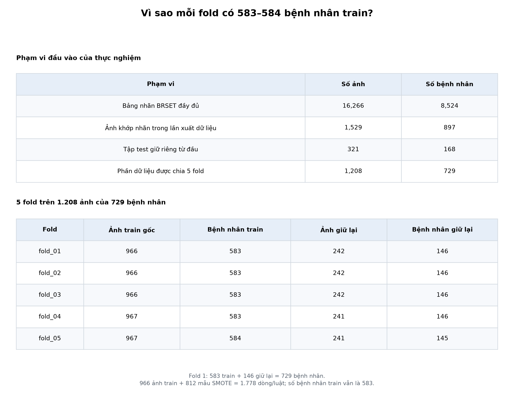
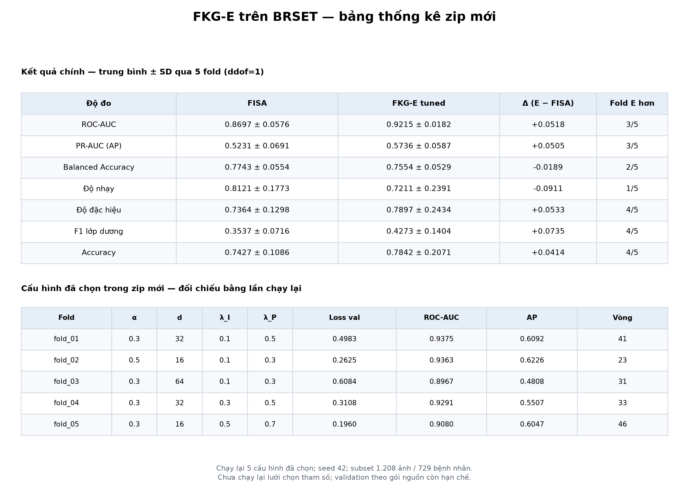
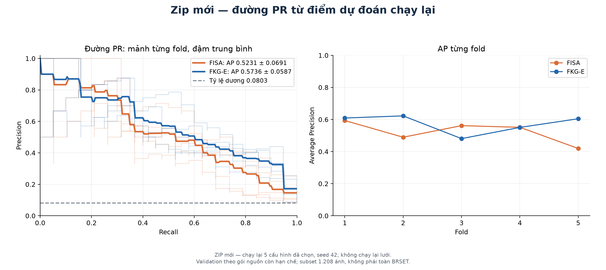
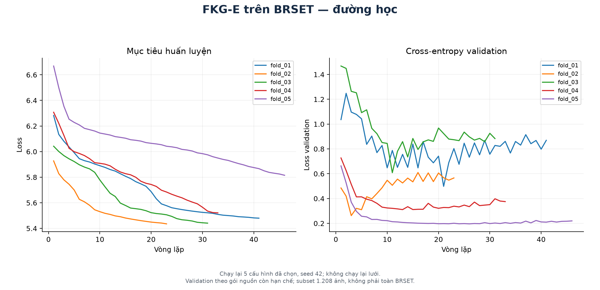

# Kết quả FKG-E trên BRSET

Đây là thư mục code tái lập và kết quả của bản FKG-E hiện tại.
Xem [báo cáo đầy đủ](results/statistics/report.md),
[bảng kết quả CSV](results/statistics/new_zip/table_main.csv) và
[giải thích số bệnh nhân theo fold](results/statistics/new_zip/patient_counts.png).

## Vì sao mỗi fold chỉ có 583–584 bệnh nhân train?

**Thực nghiệm này chia 5 fold trên 1.208 ảnh của 729 bệnh nhân.**
Phạm vi đầu vào được đối chiếu từ manifest xuất dữ liệu và
[bằng chứng số lượng đã kiểm tra](population.json):

| Phạm vi | Số ảnh | Số bệnh nhân |
|---|---:|---:|
| Bảng nhãn BRSET đầy đủ | 16.266 | 8.524 |
| Ảnh khớp nhãn trong lần xuất dữ liệu | 1.529 | 897 |
| Tập test giữ riêng từ đầu | 321 | 168 |
| Phần còn lại được chia 5 fold | 1.208 | 729 |

Code xuất dữ liệu quét các file ảnh trong thư mục đầu vào rồi ghép với nhãn.
Lần xuất dữ liệu này chỉ có 1.529 ảnh khớp nhãn. Bảng nhãn có đủ 16.266 bản ghi
không có nghĩa mọi ảnh đó đã được đưa vào pipeline. Sự thu hẹp phạm vi xảy ra
ở bước lấy ảnh đầu vào, trước khi chia fold.

Trong mỗi lượt, bốn phần dùng để train và một phần được giữ lại. Ví dụ fold 1:

- Bệnh nhân: **583 train + 146 giữ lại = 729**.
- Ảnh: **966 train + 242 giữ lại = 1.208**.
- Sau SMOTE: **966 + 812 = 1.778 dòng huấn luyện/luật**;
  số bệnh nhân train thực vẫn là **583**.

Số bệnh nhân train xấp xỉ `729 × 4/5 = 583,2`, nên các fold có 583 hoặc 584
bệnh nhân train. Không cộng số bệnh nhân train của năm lượt vì mỗi bệnh nhân
được dùng để train ở bốn lượt. Một bệnh nhân có thể có nhiều ảnh; dòng tổng hợp
SMOTE cũng không làm tăng số bệnh nhân thật.



Nếu chia 5 fold trực tiếp trên toàn bộ 8.524 bệnh nhân, mỗi lượt train sẽ khoảng
6.800 bệnh nhân. Kết quả hiện tại cần ghi rõ là thực nghiệm trên **subset BRSET**.
Muốn báo cáo trên toàn bộ BRSET phải dùng đủ ảnh, tạo lại manifest/fold,
đặc trưng, mờ hóa, cân bằng, luật và chạy lại mô hình. Chạy trên Colab nhưng
vẫn nạp các file fold/đặc trưng đã xuất sẵn sẽ giữ nguyên quy mô subset.
Tập root test 321 ảnh/168 bệnh nhân giữ riêng chưa được đánh giá trong kết quả
5 fold dưới đây.

Đã tìm thấy thêm **cache đặc trưng đầy đủ 16.266 ảnh / 8.524 bệnh nhân** trong
Git. [Thư mục CSV đầy đủ và 5 fold mới](../brset_full_features/README.md) dùng
cache đặc trưng ảnh và bảng nhãn gốc, nên không cần tải lại ảnh để chạy phần
mô hình trên các đặc trưng đã lưu. Các kết quả FKG-E trên trang này vẫn thuộc
lần chạy 1.208 ảnh; chưa được thay bằng kết quả huấn luyện toàn bộ dữ liệu.

## Kết quả chính



Kết quả FKG-E: ROC-AUC **0.9215 ± 0.0182**, AP **0.5736 ± 0.0587**.
FISA: ROC-AUC **0.8697 ± 0.0576**, AP **0.5231 ± 0.0691**.
Báo cáo có đủ bảy chỉ số phân loại, chênh lệch theo fold, cấu hình được chọn,
ngưỡng, nhiệt độ giáo viên, thông tin dừng và thời gian chạy.

Mỗi ô là trung bình ± SD mẫu qua năm fold (`ddof=1`), với seed 42.
PR-AUC dùng `sklearn.metrics.average_precision_score`; F1 là F1 lớp dương.
SD mô tả độ biến thiên giữa các fold; 50 lần đo thời gian không được coi là
50 mẫu độc lập. CI/p-value theo công thức nguồn nằm trong phụ lục tham khảo:
mẫu số hiệu chỉnh NB dùng train sau SMOTE, nên không dùng để khẳng định
ý nghĩa thống kê.





[Cấu hình từng fold](results/new_zip/selected_configurations.png) ·
[Lưới cấu hình đã lưu](results/new_zip/validation_selection_grid.png) ·
[ROC-AUC và AP chạy lại](results/new_zip/tuned_summary_replayed.png)

## Phạm vi tái lập và giới hạn

Đã chạy lại năm cấu hình được chọn trong gói nguồn, seed 42, tối đa 200 vòng,
early stopping theo code nguồn. Cả 70 giá trị phân loại (bảy chỉ số, hai mô hình,
năm fold) khớp số liệu nguồn. Lần chạy mất 501 giây; số vòng từng fold là
41, 23, 31, 33 và 46. Tất cả 20 hash kiểm tra fold khớp sau khi cho phép
chuẩn hóa xuống dòng CSV.

Đây là tái lập năm cấu hình đã chọn; lưới 108 cấu hình/fold chưa được chạy lại.
Inner validation vẫn dùng dữ liệu đã tiền xử lý/SMOTE và đồ thị nguồn.
Kết quả này chưa chứng nhận đã khắc phục thiết kế validation theo yêu cầu
phản biện. Các thực nghiệm KB2–KB6, ablation và baseline khác cần được chạy
trên pipeline hiện tại trước khi báo cáo là kết quả của phiên bản này.

## Code, môi trường và nguồn gốc

- `replay_selected.py`: chạy lại năm cấu hình từ gói nguồn với cache mới.
- `render.py`: xuất hình từ kết quả nguồn và điểm dự đoán chạy lại.
- `summarize.py`: xuất báo cáo, chín CSV và hai ảnh bảng số liệu, không huấn luyện.
- `population.json`: số lượng ở từng bước, số bệnh nhân train/giữ lại của năm fold
  và hash của bằng chứng nguồn; không chứa danh sách ID bệnh nhân hay ảnh.
- `requirements-replay.txt`: phiên bản thư viện của môi trường tái lập CPU.
- `results/figure_manifest.json` và `results/statistics/statistics_manifest.json`:
  hash gói nguồn, script, kết quả riêng và các file xuất.
- `private/`: dữ liệu, fold xuất, cache và điểm dự đoán theo từng ảnh;
  thư mục này được Git bỏ qua.

Lần chạy ngày 2026-11-01 dùng Python 3.13.7, Windows 11 Home Single Language
(10.0.26200), AMD Ryzen 5 5600H (6 nhân / 12 luồng), RAM khả dụng 7.35 GiB.
Chạy CPU với hai worker, mỗi worker một luồng BLAS. NCCL dành cho Linux
được bỏ khỏi môi trường CPU; phiên bản số học và môi trường thực tế được ghi
trong manifest. Thời gian đo phụ thuộc máy và tải, không gộp với thời gian
trong kết quả nguồn để tính speedup.

## Lệnh tái lập từ thư mục gốc repository (PowerShell)

Tạo môi trường và giải nén gói nguồn riêng do tác giả cung cấp:

```powershell
python -m venv reproducibility/fkge_result_figures/.venv
reproducibility/fkge_result_figures/.venv/Scripts/python.exe -m pip install -r reproducibility/fkge_result_figures/requirements-replay.txt
Expand-Archive -LiteralPath fkge_tuned_repro_with_data_PRIVATE.zip -DestinationPath reproducibility/fkge_result_figures/private/package
```

Chạy năm cấu hình với thư mục output mới/rỗng để tránh dùng lại cache:

```powershell
reproducibility/fkge_result_figures/.venv/Scripts/python.exe -B -X utf8 -u reproducibility/fkge_result_figures/replay_selected.py --package-root reproducibility/fkge_result_figures/private/package/fkge_tuned_repro --output reproducibility/fkge_result_figures/private/replay_local --workers 2
```

Xuất sáu ảnh và bảng thống kê của bản hiện tại:

```powershell
reproducibility/fkge_result_figures/.venv/Scripts/python.exe -B -X utf8 reproducibility/fkge_result_figures/render.py --package-zip fkge_tuned_repro_with_data_PRIVATE.zip --replay reproducibility/fkge_result_figures/private/replay_local --output reproducibility/fkge_result_figures/results
reproducibility/fkge_result_figures/.venv/Scripts/python.exe -B -X utf8 reproducibility/fkge_result_figures/summarize.py --package-zip fkge_tuned_repro_with_data_PRIVATE.zip --replay reproducibility/fkge_result_figures/private/replay_local --output reproducibility/fkge_result_figures/results/statistics
```

Linux dùng `.venv/bin/python` với cùng tham số script. `summarize.py` mặc định
đọc `population.json` cạnh script và xác nhận số lượng khớp lần chạy; dùng
`--population` để chỉ định bằng chứng quần thể khác nếu thực nghiệm thay đổi.
Gói nguồn chứa dữ liệu riêng, không nằm trong bản công khai này.
