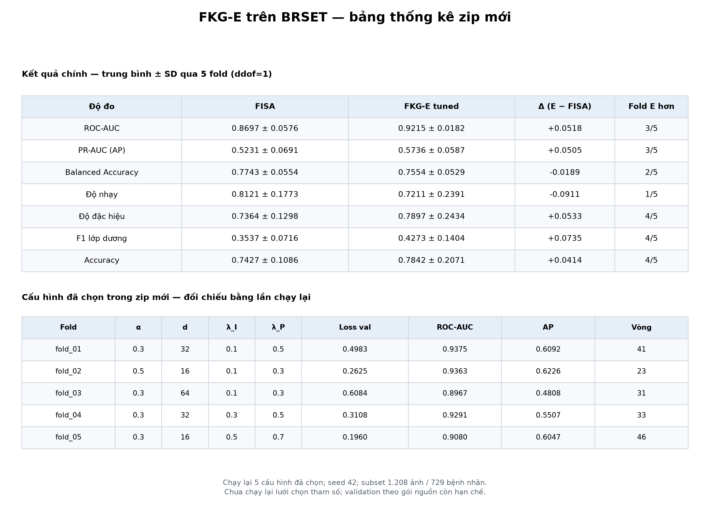
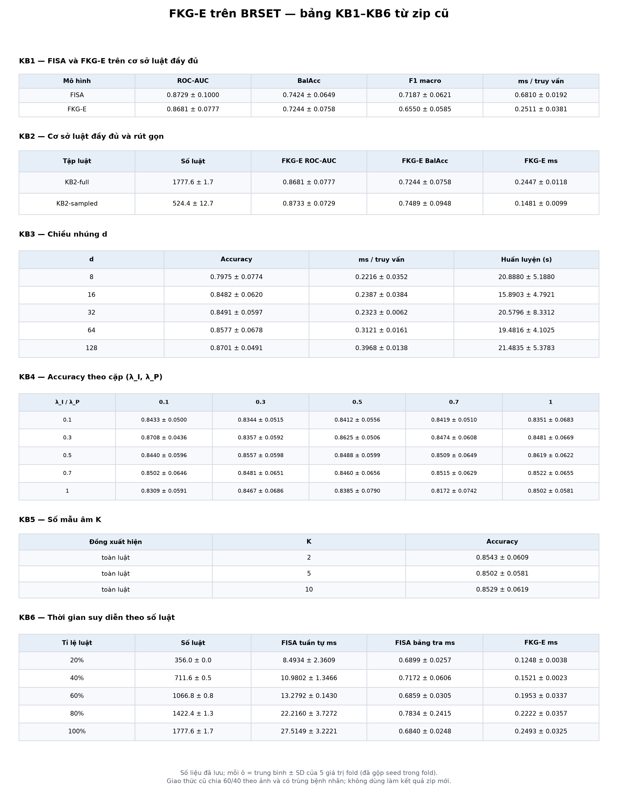

# Thống kê kết quả FKG-E theo cấu trúc báo cáo trong code

Zip mới là kết quả chính. Bảng dưới dùng lần chạy lại 5 cấu hình đã được chọn trong zip; không chạy lại quá trình chọn 108 cấu hình/fold. Seed 42, tối đa 200 vòng, early stopping theo nguồn.

Mỗi ô là trung bình ± SD mẫu qua **5 fold** (`ddof=1`). Với zip cũ, gộp seed trong từng fold trước; không coi fold × seed hay 50 lần đo thời gian là 50 mẫu độc lập. Các fold dùng chung một phần dữ liệu huấn luyện, nên SD này chỉ mô tả độ biến thiên, không khẳng định ý nghĩa thống kê.

## 1. Zip mới — kết quả chính FISA và FKG-E tuned

| Độ đo | FISA | FKG-E | Δ (FKG-E − FISA) | Fold FKG-E hơn |
| --- | --- | --- | --- | --- |
| ROC-AUC | 0.8697 ± 0.0576 | 0.9215 ± 0.0182 | +0.0518 | 3/5 |
| PR-AUC (AP) | 0.5231 ± 0.0691 | 0.5736 ± 0.0587 | +0.0505 | 3/5 |
| Balanced Accuracy | 0.7743 ± 0.0554 | 0.7554 ± 0.0529 | -0.0189 | 2/5 |
| Độ nhạy | 0.8121 ± 0.1773 | 0.7211 ± 0.2391 | -0.0911 | 1/5 |
| Độ đặc hiệu | 0.7364 ± 0.1298 | 0.7897 ± 0.2434 | +0.0533 | 4/5 |
| F1 lớp dương | 0.3537 ± 0.0716 | 0.4273 ± 0.1404 | +0.0735 | 4/5 |
| Accuracy | 0.7427 ± 0.1086 | 0.7842 ± 0.2071 | +0.0414 | 4/5 |

PR-AUC là Average Precision theo code nguồn. F1 ở bảng này là **F1 lớp dương**. Các chỉ số dùng ngưỡng của mô hình nguồn; AUC/AP dùng điểm liên tục. AUC/AP tốt hơn không đồng nghĩa mọi chỉ số phân loại tốt hơn.

[CSV kết quả chính](new_zip/table_main.csv) · [70 phép đối chiếu với zip](new_zip/table_replay_checks.csv)

Chênh lệch lớn nhất so với 7 chỉ số × 2 mô hình × 5 fold trong zip: `0`. Các con số phản ánh subset **1.208 ảnh / 729 bệnh nhân**. Inner validation vẫn dùng dữ liệu đã tiền xử lý/SMOTE và đồ thị nguồn; bảng này không chứng nhận đã khắc phục yêu cầu validation của phản biện.

## 2. Zip mới — cấu hình và từng fold

| Fold | α | d | λ_I | λ_P | Loss val | AUC val | AP val | AUC test | AP test | Vòng |
| --- | --- | --- | --- | --- | --- | --- | --- | --- | --- | --- |
| fold_01 | 0.3000 | 32 | 0.1000 | 0.5000 | 0.4983 | 0.8504 | 0.7584 | 0.9375 | 0.6092 | 41 |
| fold_02 | 0.5000 | 16 | 0.1000 | 0.3000 | 0.2625 | 0.9621 | 0.9385 | 0.9363 | 0.6226 | 23 |
| fold_03 | 0.3000 | 64 | 0.1000 | 0.3000 | 0.6084 | 0.7618 | 0.7516 | 0.8967 | 0.4808 | 31 |
| fold_04 | 0.3000 | 32 | 0.3000 | 0.5000 | 0.3108 | 0.9473 | 0.9192 | 0.9291 | 0.5507 | 33 |
| fold_05 | 0.3000 | 16 | 0.5000 | 0.7000 | 0.1960 | 0.9977 | 0.9973 | 0.9080 | 0.6047 | 46 |

[CSV cấu hình](new_zip/table_selected_folds.csv) · [Chỉ số từng fold và mô hình](new_zip/table_fold_metrics.csv) · [Toàn bộ lưới đã lưu](new_zip/table_archived_grid.csv)

## 3. Zip mới — chia dữ liệu và thông số chạy

| Fold | Train trước SMOTE | Train sau SMOTE / luật | Bệnh nhân train | SMOTE | Học / val | Test (dương) |
| --- | --- | --- | --- | --- | --- | --- |
| fold_01 | 966 | 1778 | 583 | 812 | 1421 / 357 | 242 (20) |
| fold_02 | 966 | 1776 | 583 | 810 | 1421 / 355 | 242 (19) |
| fold_03 | 966 | 1776 | 583 | 810 | 1420 / 356 | 242 (19) |
| fold_04 | 967 | 1780 | 583 | 813 | 1424 / 356 | 241 (20) |
| fold_05 | 967 | 1778 | 584 | 811 | 1422 / 356 | 241 (19) |

| Chỉ số phụ của 5 cấu hình đã chọn | Trung bình ± SD |
| --- | --- |
| Đồng thuận nhãn FISA | 0.7800 ± 0.1201 |
| Dev căn cứ luật | 0.5097 ± 0.0785 |
| FISA bảng tra (ms/truy vấn, replay) | 1.2003 ± 0.0764 |
| FISA tuần tự (ms/truy vấn, replay) | 35.6372 ± 0.6150 |
| FKG-E (ms/truy vấn, replay) | 0.2667 ± 0.0378 |
| Huấn luyện FKG-E (s, replay) | 82.4647 ± 18.9715 |
| Huấn luyện FKG-E (s, tác giả lưu) | 33.1691 ± 14.8484 |

Thời gian phụ thuộc máy và tải khi chạy hai worker; không gộp thời gian tác giả với replay để tính speedup. Số luật là số dòng sau SMOTE, không phải số bệnh nhân. [CSV chia dữ liệu](new_zip/table_split.csv) · [Ngưỡng, T, gradient, dừng và thời gian](new_zip/table_auxiliary.csv)

## 4. Đối chiếu CI/p-value do code gốc tính

Mục này chỉ tái hiện công thức trong `fkge_branch/report/report_nested.py`: CI t có 4 bậc tự do; p NB dùng tỉ lệ test/train **sau SMOTE**. Tỉ lệ đó khác số ảnh train gốc (test/train trước SMOTE = 0,25). CI có thể vượt [0;1]. Không dùng các cột này để khẳng định ý nghĩa thống kê hay xem 5 fold là các thí nghiệm độc lập.

| Độ đo | CI95 FKG-E theo code gốc | p NB theo code gốc |
| --- | --- | --- |
| auc | [0.8989; 0.9441] | 0.202 |
| pr_auc | [0.5008; 0.6464] | 0.462 |
| balanced_accuracy | [0.6897; 0.8211] | 0.714 |
| sensitivity | [0.4242; 1.0179] | 0.354 |
| specificity | [0.4875; 1.0919] | 0.727 |
| f1_pos | [0.2530; 0.6015] | 0.493 |
| accuracy | [0.5270; 1.0413] | 0.759 |

[CSV công thức gốc để đối chiếu](new_zip/table_reference_inference.csv)

## 5. Zip cũ — KB1–KB6, ablation và baseline

Đây là số liệu lịch sử của giao thức 60/40 theo ảnh, có trùng bệnh nhân giữa hai phần. F1 ở KB1/KB2 và ablation là **F1 macro**, không đánh đồng với F1 lớp dương của zip mới. Các chỉ số không có trong JSON gốc được để thiếu; không suy ra AP từ ROC-AUC.

### KB1

| Cấu hình | n_rules | fisa_accuracy | fisa_bacc | fisa_auc | fisa_f1 | fkge_accuracy_mean | fkge_bacc_mean | fkge_auc_mean | fkge_f1_mean | fkge_avg_ms_mean |
| --- | --- | --- | --- | --- | --- | --- | --- | --- | --- | --- |
| dataset=BRSET (FKG-MM) | 1777.6000 ± 1.6733 | 0.9031 ± 0.0347 | 0.7424 ± 0.0649 | 0.8729 ± 0.1000 | 0.7187 ± 0.0621 | 0.8491 ± 0.0597 | 0.7244 ± 0.0758 | 0.8681 ± 0.0777 | 0.6550 ± 0.0585 | 0.2511 ± 0.0381 |

[CSV đầy đủ KB1](old_zip/table_KB1.csv)

### KB2

| Cấu hình | n_rules | fisa_accuracy | fisa_bacc | fisa_auc | fkge_accuracy_mean | fkge_bacc_mean | fkge_auc_mean | fkge_avg_ms_mean | speedup |
| --- | --- | --- | --- | --- | --- | --- | --- | --- | --- |
| kb=KB2-full | 1777.6000 ± 1.6733 | 0.9031 ± 0.0347 | 0.7424 ± 0.0649 | 0.8729 ± 0.1000 | 0.8491 ± 0.0597 | 0.7244 ± 0.0758 | 0.8681 ± 0.0777 | 0.2447 ± 0.0118 | 2.8431 ± 0.2152 |
| kb=KB2-sampled | 524.4000 ± 12.7397 | 0.9052 ± 0.0360 | 0.7435 ± 0.0646 | 0.8883 ± 0.0838 | 0.8482 ± 0.0625 | 0.7489 ± 0.0948 | 0.8733 ± 0.0729 | 0.1481 ± 0.0099 | 4.7908 ± 0.7349 |

[CSV đầy đủ KB2](old_zip/table_KB2.csv)

### KB3

| Cấu hình | accuracy_mean | avg_ms_mean | train_time_s_mean |
| --- | --- | --- | --- |
| d=8 | 0.7975 ± 0.0774 | 0.2216 ± 0.0352 | 20.8880 ± 5.1880 |
| d=16 | 0.8482 ± 0.0620 | 0.2387 ± 0.0384 | 15.8903 ± 4.7921 |
| d=32 | 0.8491 ± 0.0597 | 0.2323 ± 0.0062 | 20.5796 ± 8.3312 |
| d=64 | 0.8577 ± 0.0678 | 0.3121 ± 0.0161 | 19.4816 ± 4.1025 |
| d=128 | 0.8701 ± 0.0491 | 0.3968 ± 0.0138 | 21.4835 ± 5.3783 |

[CSV đầy đủ KB3](old_zip/table_KB3.csv)

### KB4

| Cấu hình | accuracy_mean | agreement_mean | dev_mean |
| --- | --- | --- | --- |
| lambda=0.1, beta=0.1 | 0.8433 ± 0.0500 | 0.8770 ± 0.0439 | 0.2619 ± 0.0503 |
| lambda=0.1, beta=0.3 | 0.8344 ± 0.0515 | 0.8612 ± 0.0456 | 0.2846 ± 0.0467 |
| lambda=0.1, beta=0.5 | 0.8412 ± 0.0556 | 0.8639 ± 0.0364 | 0.2945 ± 0.0400 |
| lambda=0.1, beta=0.7 | 0.8419 ± 0.0510 | 0.8632 ± 0.0390 | 0.2956 ± 0.0383 |
| lambda=0.1, beta=1.0 | 0.8351 ± 0.0683 | 0.8495 ± 0.0385 | 0.3162 ± 0.0309 |
| lambda=0.3, beta=0.1 | 0.8708 ± 0.0436 | 0.9086 ± 0.0159 | 0.2529 ± 0.0304 |
| lambda=0.3, beta=0.3 | 0.8357 ± 0.0592 | 0.8694 ± 0.0552 | 0.2863 ± 0.0598 |
| lambda=0.3, beta=0.5 | 0.8625 ± 0.0506 | 0.8921 ± 0.0436 | 0.2701 ± 0.0414 |
| lambda=0.3, beta=0.7 | 0.8474 ± 0.0608 | 0.8742 ± 0.0571 | 0.2969 ± 0.0479 |
| lambda=0.3, beta=1.0 | 0.8481 ± 0.0669 | 0.8708 ± 0.0561 | 0.3045 ± 0.0449 |
| lambda=0.5, beta=0.1 | 0.8440 ± 0.0596 | 0.8804 ± 0.0506 | 0.2850 ± 0.0507 |
| lambda=0.5, beta=0.3 | 0.8557 ± 0.0598 | 0.8907 ± 0.0520 | 0.2752 ± 0.0503 |
| lambda=0.5, beta=0.5 | 0.8488 ± 0.0599 | 0.8838 ± 0.0523 | 0.2876 ± 0.0487 |
| lambda=0.5, beta=0.7 | 0.8509 ± 0.0649 | 0.8832 ± 0.0503 | 0.2930 ± 0.0474 |
| lambda=0.5, beta=1.0 | 0.8619 ± 0.0622 | 0.8859 ± 0.0495 | 0.2981 ± 0.0439 |
| lambda=0.7, beta=0.1 | 0.8502 ± 0.0646 | 0.8825 ± 0.0622 | 0.2934 ± 0.0706 |
| lambda=0.7, beta=0.3 | 0.8481 ± 0.0651 | 0.8832 ± 0.0589 | 0.2925 ± 0.0435 |
| lambda=0.7, beta=0.5 | 0.8460 ± 0.0656 | 0.8811 ± 0.0603 | 0.2940 ± 0.0558 |
| lambda=0.7, beta=0.7 | 0.8515 ± 0.0629 | 0.8811 ± 0.0508 | 0.2967 ± 0.0525 |
| lambda=0.7, beta=1.0 | 0.8522 ± 0.0655 | 0.8804 ± 0.0557 | 0.3037 ± 0.0519 |
| lambda=1.0, beta=0.1 | 0.8309 ± 0.0591 | 0.8729 ± 0.0621 | 0.3092 ± 0.0471 |
| lambda=1.0, beta=0.3 | 0.8467 ± 0.0686 | 0.8859 ± 0.0628 | 0.3073 ± 0.0437 |
| lambda=1.0, beta=0.5 | 0.8385 ± 0.0790 | 0.8722 ± 0.0756 | 0.3144 ± 0.0695 |
| lambda=1.0, beta=0.7 | 0.8172 ± 0.0742 | 0.8481 ± 0.0780 | 0.3303 ± 0.0819 |
| lambda=1.0, beta=1.0 | 0.8502 ± 0.0581 | 0.8825 ± 0.0453 | 0.3051 ± 0.0448 |

[CSV đầy đủ KB4](old_zip/table_KB4.csv)

### KB5

| Cấu hình | accuracy_mean |
| --- | --- |
| w=toàn luật, K=2 | 0.8543 ± 0.0609 |
| w=toàn luật, K=5 | 0.8502 ± 0.0581 |
| w=toàn luật, K=10 | 0.8529 ± 0.0619 |

[CSV đầy đủ KB5](old_zip/table_KB5.csv)

### KB6

| Cấu hình | n_rules | fisa_seq_avg_ms | fisa_avg_ms | fkge_avg_ms_mean | fisa_bacc | fkge_accuracy_mean |
| --- | --- | --- | --- | --- | --- | --- |
| ratio=0.2 | 356.0000 ± 0.0000 | 8.4934 ± 2.3609 | 0.6899 ± 0.0257 | 0.1248 ± 0.0038 | 0.7629 ± 0.0408 | 0.8591 ± 0.0499 |
| ratio=0.4 | 711.6000 ± 0.5477 | 10.9802 ± 1.3466 | 0.7172 ± 0.0606 | 0.1521 ± 0.0023 | 0.7334 ± 0.0945 | 0.8639 ± 0.0530 |
| ratio=0.6 | 1066.8000 ± 0.8367 | 13.2792 ± 0.1430 | 0.6859 ± 0.0305 | 0.1953 ± 0.0337 | 0.7402 ± 0.0908 | 0.8577 ± 0.0759 |
| ratio=0.8 | 1422.4000 ± 1.3416 | 22.2160 ± 3.7272 | 0.7834 ± 0.2415 | 0.2222 ± 0.0357 | 0.7299 ± 0.0856 | 0.8419 ± 0.0913 |
| ratio=1.0 | 1777.6000 ± 1.6733 | 27.5149 ± 3.2221 | 0.6840 ± 0.0248 | 0.2493 ± 0.0325 | 0.7424 ± 0.0649 | 0.8454 ± 0.0963 |

[CSV đầy đủ KB6](old_zip/table_KB6.csv)

### ablation

| Cấu hình | accuracy_mean | balanced_accuracy_mean | auc_mean | f1_macro_mean | log_loss_mean | agreement_fisa_mean | dev_rule_mean |
| --- | --- | --- | --- | --- | --- | --- | --- |
| variant=Full FKG-E | 0.8491 ± 0.0597 | 0.7244 ± 0.0758 | 0.8681 ± 0.0777 | 0.6550 ± 0.0585 | 0.2171 ± 0.0440 | 0.8775 ± 0.0431 | 0.3076 ± 0.0469 |
| variant=Bỏ L_pred (λ_P = 0) | 0.8392 ± 0.0670 | 0.7258 ± 0.0740 | 0.8454 ± 0.0895 | 0.6528 ± 0.0607 | 0.2394 ± 0.0327 | 0.8775 ± 0.0591 | 0.3155 ± 0.0557 |
| variant=Bỏ L_inf (λ_I = 0) | 0.8285 ± 0.0701 | 0.6949 ± 0.1420 | 0.8380 ± 0.1212 | 0.6271 ± 0.0991 | 0.2355 ± 0.0664 | 0.8371 ± 0.0529 | 0.3288 ± 0.0581 |
| variant=Bỏ L_rule (λ_R = 0) | 0.8351 ± 0.0690 | 0.7440 ± 0.0774 | 0.8708 ± 0.0769 | 0.6558 ± 0.0608 | 0.2177 ± 0.0439 | 0.8635 ± 0.0602 | 0.4190 ± 0.0451 |
| variant=Bỏ bảo toàn cạnh (λ_E = 0) | 0.8511 ± 0.0625 | 0.7323 ± 0.0674 | 0.8665 ± 0.0794 | 0.6624 ± 0.0595 | 0.2175 ± 0.0447 | 0.8779 ± 0.0443 | 0.3120 ± 0.0401 |
| variant=Bỏ bảo toàn nút (λ_N = 0) | 0.8503 ± 0.0618 | 0.7364 ± 0.0705 | 0.8651 ± 0.0809 | 0.6645 ± 0.0622 | 0.2168 ± 0.0432 | 0.8755 ± 0.0461 | 0.3154 ± 0.0430 |
| variant=Bỏ cấu trúc (λ_E = λ_N = 0) | 0.8470 ± 0.0649 | 0.7323 ± 0.0762 | 0.8640 ± 0.0806 | 0.6566 ± 0.0595 | 0.2172 ± 0.0438 | 0.8705 ± 0.0492 | 0.3162 ± 0.0489 |
| variant=Gộp trung bình đều (α = r/(r+1)) | 0.8652 ± 0.0435 | 0.7763 ± 0.0514 | 0.9145 ± 0.0442 | 0.6884 ± 0.0406 | 0.2043 ± 0.0335 | 0.9035 ± 0.0430 | 0.2309 ± 0.0411 |

[CSV đầy đủ ablation](old_zip/table_ablation.csv)

### baseline

| Cấu hình | accuracy | f1 | train_time_s | avg_ms_per_query |
| --- | --- | --- | --- | --- |
| method=FISA (Chương 2) | 0.9031 ± 0.0347 | 0.7187 ± 0.0621 | 0.3637 ± 0.0079 | 0.6678 ± 0.0082 |
| method=Node2Vec + kNN | 0.8482 ± 0.0412 | 0.6421 ± 0.0500 | 3.5785 ± 0.1220 | 0.1108 ± 0.0157 |
| method=TransE + kNN | 0.8507 ± 0.0449 | 0.6426 ± 0.0819 | 4.2268 ± 0.0821 | 0.1064 ± 0.0060 |
| method=DistMult + kNN | 0.8515 ± 0.0386 | 0.6469 ± 0.0566 | 4.8738 ± 0.1540 | 0.1082 ± 0.0038 |
| method=FKG-E (đề xuất) | 0.8491 ± 0.0597 | 0.6550 ± 0.0585 | 20.3844 ± 8.2015 | 0.2753 ± 0.0515 |

[CSV đầy đủ baseline](old_zip/table_baseline.csv)

## 6. Phần kết quả thực sự có trong từng gói

| Nhóm | Zip mới | Zip cũ |
| --- | --- | --- |
| FKG-E tuned (α, d, λ_I, λ_P) | 5 fold đã chọn + 108 cấu hình/fold đã lưu; replay 5 cấu hình | Không có lưới tương ứng |
| KB1–KB6, ablation, baseline | Không có JSON kết quả tương ứng; không lấy số cũ gắn nhãn mới | Đủ JSON từng fold, được thống kê lại ở trên |
| Default FKG-E trong report_nested.md | Chỉ có bảng Markdown được lưu; chưa replay trong lần này | Giao thức khác |

Không trộn kết quả của module `fkge_v2` với mô hình trong hai zip: chỉ tham khảo cách trình bày bảng của `fkge_v2/report/render_brset_quick_table.py`. Không chọn cấu hình theo chỉ số test cao nhất. Xem `statistics_manifest.json` để đối chiếu SHA256 nguồn, script và các file được xuất.
